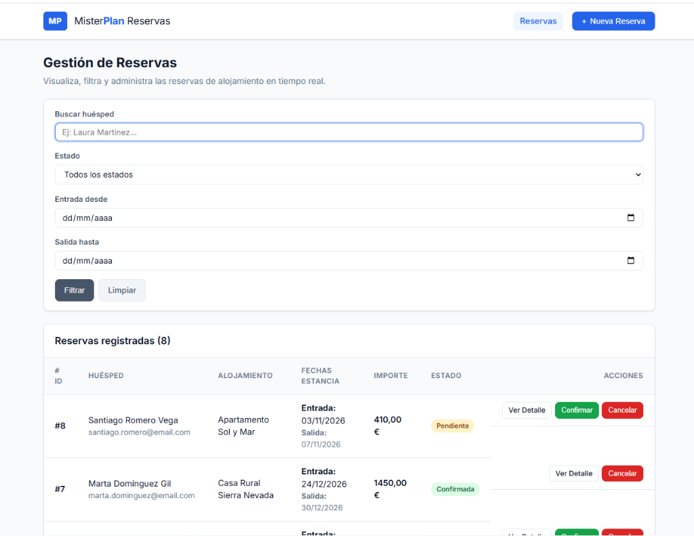

# Sistema de Gestión de Reservas de Alojamiento — MisterPlan

Prueba técnica para el puesto de **Desarrollador/a Junior PHP** en **MisterPlan**.  
Aplicación web desarrollada en **PHP nativo (sin frameworks)**, vistas renderizadas con **Twig**, persistencia en **MySQL/MariaDB**, e interfaz dinámica con **JavaScript Vanilla**.

---

## 🌐 Despliegue en Producción (Demo Online)

- **URL de la aplicación en vivo:** **[https://jorgecg645.alwaysdata.net](https://jorgecg645.alwaysdata.net)**
- **API REST (JSON):** [https://jorgecg645.alwaysdata.net/api/reservas](https://jorgecg645.alwaysdata.net/api/reservas)



---

## 🚀 Cómo levantarlo en local (Paso a paso)

### Requisitos previos
- PHP 8.1 o superior (con extensiones `pdo_mysql`, `mbstring`).
- MySQL o MariaDB (por ejemplo a través de XAMPP, WAMP o MAMP).
- Composer (para instalar Twig y PHPUnit).

### 1. Clonar el repositorio
```bash
git clone https://github.com/jorgecg646/misterplan-reservas-junior.git
cd misterplan-reservas-junior
```

### 2. Instalar dependencias
```bash
composer install
```
*(Nota: Solo instala Twig para las vistas y PHPUnit en entorno de desarrollo. No se utiliza ningún framework).*

### 3. Crear e importar la base de datos
1. Inicia MySQL en tu servidor local (ej. XAMPP o MAMP).
2. Abre tu gestor de base de datos favorito (phpMyAdmin o consola) e importa el archivo `database/reservas.sql`:
   ```bash
   mysql -u root -p < database/reservas.sql
   ```
   *(Este archivo crea automáticamente la base de datos `reservas_db`, las tablas `reserva` y `reserva_evento`, y carga 8 reservas de prueba con su historial de eventos en UTF-8).*

### 4. Configurar variables de entorno (Opcional)
Por defecto, la aplicación se conecta a `127.0.0.1:3306`, base de datos `reservas_db`, usuario `root` y contraseña vacía (la configuración habitual de XAMPP). Si tu configuración local o de hosting es diferente, puedes definir las siguientes variables de entorno:
- `DB_HOST`: Host de MySQL (ej. `localhost`)
- `DB_PORT`: Puerto de conexión (ej. `3306`)
- `DB_NAME`: Nombre de la base de datos (`reservas_db`)
- `DB_USER`: Usuario de base de datos (ej. `root`)
- `DB_PASS`: Contraseña de base de datos

### 5. Iniciar el servidor local
Puedes utilizar el servidor web integrado de PHP apuntando a la carpeta pública:
```bash
php -S localhost:8000 -t public
```
Abre tu navegador en: **[http://localhost:8000](http://localhost:8000)**

---

## 🧪 Ejecución de Tests Unitarios

Para ejecutar la suite de pruebas unitarias con PHPUnit:
```bash
vendor/bin/phpunit
```
Se comprueban las reglas de validación del servicio (`fecha_salida > fecha_entrada`, emails válidos, importes > 0, control de estados) y la correcta emisión de eventos en el historial.

---

## 📐 Decisiones de Diseño y Arquitectura

### 1. Separación de capas (Sin Framework)
Para mantener un código legible, desacoplado y fácil de mantener sin apoyarnos en Laravel ni Symfony, organicé el proyecto siguiendo el principio de responsabilidad única (SRP):
- **Core (`App\Database`)**: Centraliza la conexión PDO utilizando un patrón Singleton simple, configurando el modo de errores por excepción (`ERRMODE_EXCEPTION`) y forzando codificación `utf8mb4`.
- **Capa de Datos / Repositorios (`ReservaRepository`, `EventoRepository`)**: Aísla el acceso a SQL. Todas las consultas utilizan **sentencias preparadas (Prepared Statements)** con vinculación de parámetros (`bindValue`), garantizando protección total contra inyecciones SQL.
- **Capa de Negocio / Servicio (`ReservaService`)**: Contiene las reglas de validación en servidor (fechas, email, importes). Además, gestiona **transacciones atómicas (`beginTransaction` / `commit` / `rollBack`)** para asegurar que toda reserva creada o actualizada registre su correspondiente entrada en el historial de eventos (`reserva_evento`).
- **Controladores (`ReservaApiController` y `ViewController`)**: El controlador API gestiona el formato JSON y códigos de estado HTTP (`200`, `201`, `400`, `404`, `422`), mientras que el de vistas se encarga del renderizado en Twig.
- **Enrutador nativo (`public/index.php`)**: Un Front Controller artesanal con resolución de rutas y métodos HTTP (`GET`, `POST`, `PATCH`), fácil de auditar y sin dependencias externas.

### 2. Motor de plantillas Twig
- Se utiliza una plantilla base (`templates/base.html.twig`) con herencia (``, ``) para evitar la duplicación de encabezados HTML y estilos.
- Se aprovecha el **autoescaping** nativo de Twig para proteger las vistas contra ataques XSS.
- Formateo directo en plantilla mediante filtros Twig (`|date('d/m/Y')`, `|number_format(2, ',', '.')`).

### 3. Interfaz Dinámica con JavaScript Vanilla
- Peticiones asíncronas con la API nativa `fetch()` sin recargar la página.
- Búsqueda en vivo con *debounce* de 300ms para no saturar el servidor mientras el usuario escribe.
- Ventana modal con doble validación (cliente inmediata y captura de errores `422` del servidor).
- Diálogo nativo de confirmación antes de cancelar una reserva.
- Feedback visual con indicadores de carga e informativos de éxito/error.

---

## 🔮 Qué haría diferente con más tiempo

1. **Autenticación y Roles**: Incorporar autenticación mediante sesiones seguras o tokens JWT con control de acceso por roles (ej. recepcionista vs. administrador).
2. **Paginación en Servidor**: Añadir paginación en `GET /api/reservas` (`?page=1&limit=15`) para que el rendimiento no decaiga cuando existan miles de reservas registradas.
3. **Dockerización completa**: Añadir un archivo `docker-compose.yml` con contenedores para PHP-FPM, Nginx y MySQL/MariaDB para arrancar todo el entorno con un solo comando `docker compose up`.
4. **Mayor cobertura de tests**: Implementar tests de integración contra una base de datos de pruebas (usando SQLite en memoria para máxima velocidad de ejecución en pipelines de CI/CD).
5. **Soft Deletes**: En lugar de solo marcar estado `cancelada`, permitir borrado lógico con un campo `deleted_at`.

---

## ⚡ Escalabilidad: ¿Qué cambiaría si recibiera 1.000 reservas/hora?

Procesar ~1.000 reservas/hora (~17 reservas/minuto de promedio, con picos de 50-100 reservas/minuto en campañas) requiere transformar la arquitectura hacia un modelo desacoplado y preparado para alta concurrencia:

1. **Colas de Mensajes Asíncronas (RabbitMQ o Redis Queue)**:
   - Actualmente, al crear una reserva se guardan datos, se auditan eventos y en un entorno real se enviaría un email de confirmación.
   - Con alta carga, las tareas pesadas (notificaciones por email/SMS, generación de PDFs de confirmación, webhooks a channel managers) deben enviarse a una cola en segundo plano mediante workers asíncronos para responder al usuario en menos de 50ms.
2. **Caché en Memoria (Redis / Memcached)**:
   - Los listados de disponibilidad y consultas frecuentes no deben golpear a MySQL en cada petición. Guardar en Redis la disponibilidad con invalidación por eventos al crear una nueva reserva.
3. **Separación de Lectura y Escritura en Base de Datos (Read/Write Replicas)**:
   - Mantener un nodo principal (Master) dedicado exclusivamente a transacciones de escritura (`INSERT`, `UPDATE`), y réplicas de solo lectura (Read Replicas) para consultas de listados, filtros y reportes.
4. **Optimización de Índices de Base de Datos**:
   - Crear índices compuestos en MySQL según los patrones de búsqueda más repetidos, por ejemplo: `INDEX (estado, fecha_entrada)` y búsqueda Full-Text para nombres de huéspedes.
5. **Servidor Web y Balanceo de Carga**:
   - Desplegar detrás de un balanceador de carga (Nginx / AWS ALB) con múltiples instancias de PHP-FPM sin estado (*stateless*), lo que permite escalar horizontalmente de forma automática (Auto-scaling) según el tráfico.
6. **Rate Limiting y Protección de API**:
   - Implementar limitadores de peticiones (ej. 60 peticiones/minuto por IP) para evitar ataques de denegación de servicio o scraping agresivo de reservas.

---

## 📦 Estructura del Proyecto

```text
├── config/
│   └── database.php             # Configuración PDO con fallback a variables de entorno
├── database/
│   └── reservas.sql             # Script DDL + Datos de ejemplo en UTF-8
├── public/                      # Raíz pública del servidor web
│   ├── css/
│   │   └── app.css              # Estilos limpios, modernos y responsive
│   ├── js/
│   │   └── app.js               # JavaScript Vanilla (AJAX, filtros, modal y acciones)
│   └── index.php                # Front Controller y enrutador principal
├── src/
│   ├── Controllers/
│   │   ├── ReservaApiController.php  # Endpoints JSON con códigos HTTP correctos
│   │   └── ViewController.php        # Renderizado de plantillas con Twig
│   ├── Database.php             # Conexión Singleton PDO segura
│   ├── Exceptions/
│   │   └── ValidationException.php   # Excepción para errores de validación (422)
│   ├── Repositories/
│   │   ├── EventoRepository.php      # Consultas SQL para el historial de eventos
│   │   └── ReservaRepository.php     # Consultas SQL preparadas para reservas
│   └── Services/
│       └── ReservaService.php        # Lógica de negocio, validaciones y transacciones
├── templates/                   # Plantillas Twig con herencia
│   ├── base.html.twig           # Layout general (navbar, container, alertas, footer)
│   └── reservas/
│       ├── detalle.html.twig    # Ficha técnica + Timeline cronológico de auditoría
│       └── index.html.twig      # Tabla de reservas con filtros y modal de creación
├── tests/
│   └── ReservaServiceTest.php   # Tests unitarios con PHPUnit
├── composer.json                # Configuración PSR-4 y dependencias
├── phpunit.xml                  # Configuración del ejecutor de tests
├── .gitignore
└── README.md
```

---

## 👨‍💻 Autor

- **Jorge Castillo** — *Prueba técnica desarrollada para MisterPlan.*